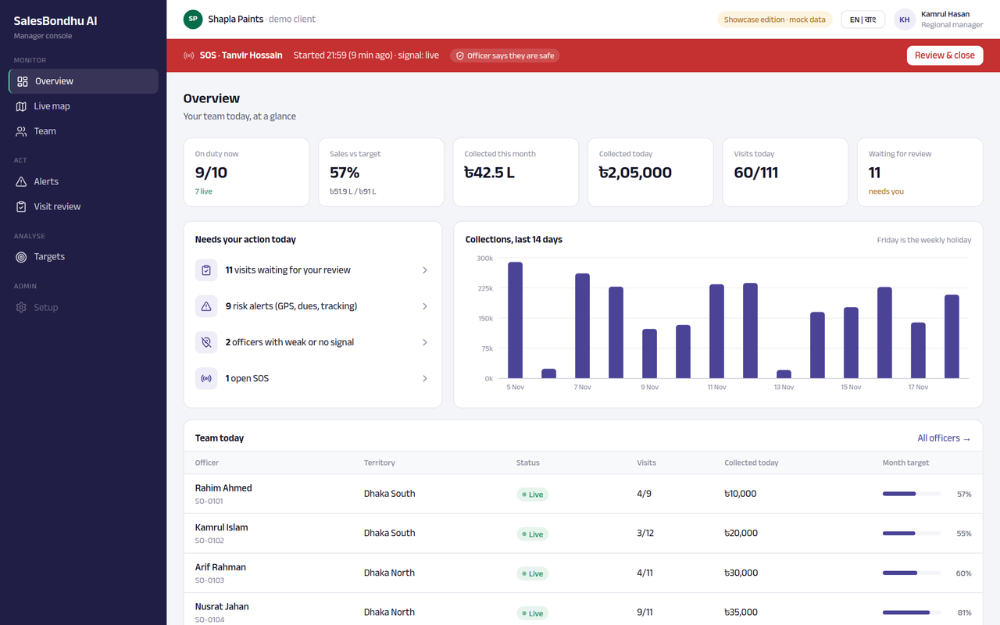
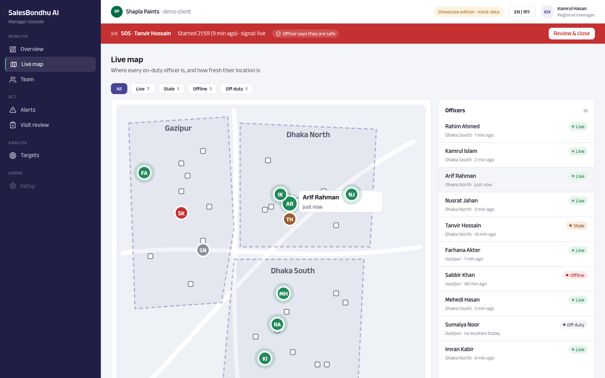
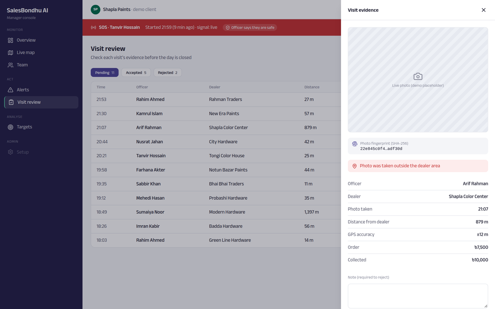
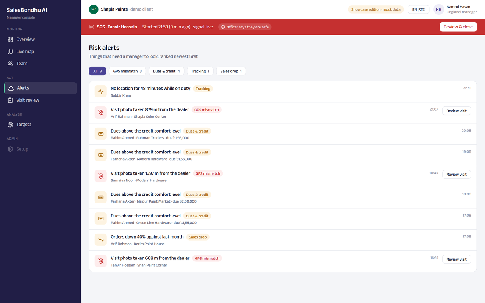
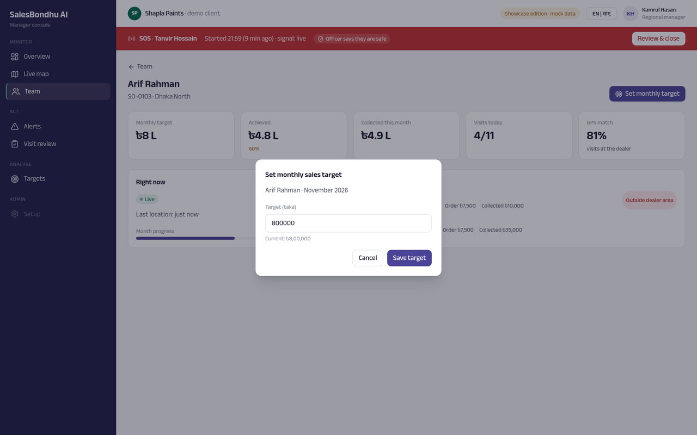
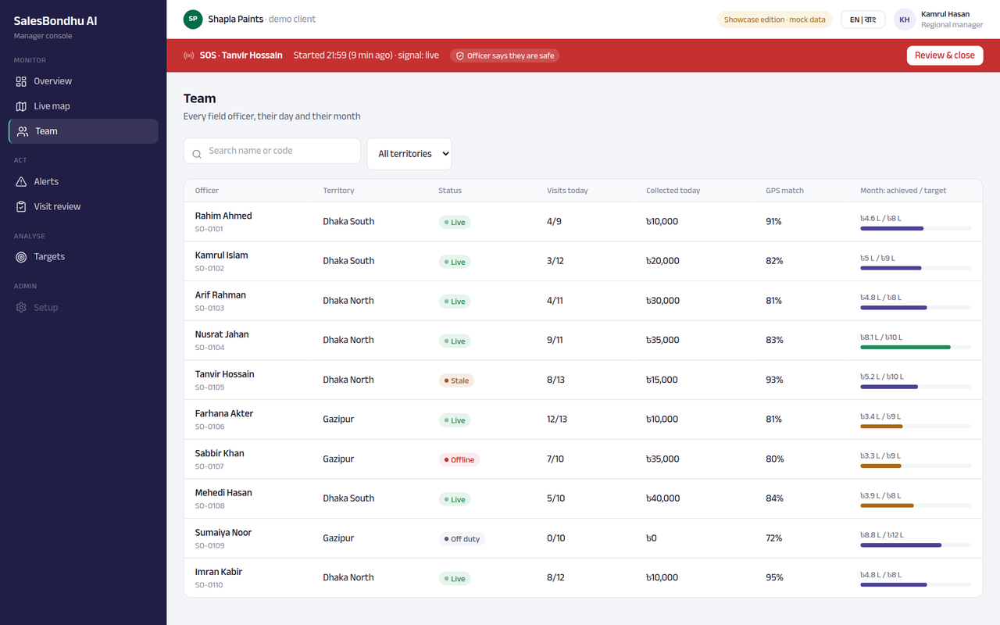
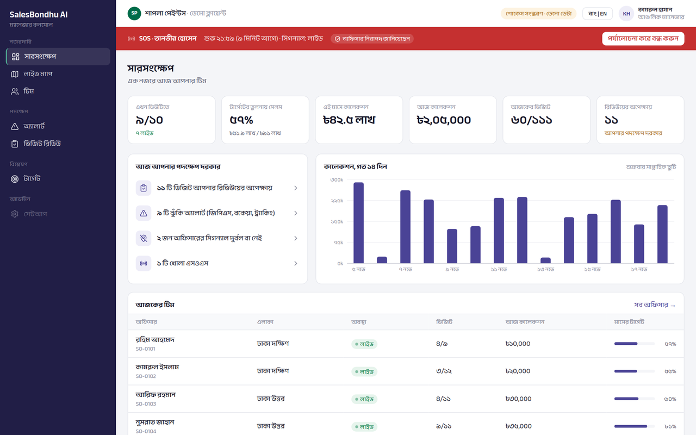

# SalesBondhu AI · Manager Console

**The web console where sales managers watch their field team live, act on risks and review every visit.**

[](https://github.com/muhammadTasin/SalesBondhu-AI-Web/actions/workflows/ci.yml)


> **Public showcase edition.** The production console is private under client confidentiality; this
> repository is a UI build with mock data and service stubs, written for the public. It mirrors the
> real console's pages, layout and behaviour; every officer, dealer, amount and photo is invented.

This is the manager side of **SalesBondhu AI**, a Bangla-first field-sales co-pilot that is in a live
pilot with **Aqua Paints**' field sales team in Bangladesh. The field officer app and the AI sales
coach are in the companion repo: **[SalesBondhu-AI](https://github.com/muhammadTasin/SalesBondhu-AI)**.



## What a manager can do

| Page | What it answers | Code |
|---|---|---|
| **Overview** | How is my team doing today? What needs me right now? | [`OverviewPage`](src/pages/OverviewPage.tsx) |
| **Live map** | Where is everyone, and how fresh is each location (live / stale / offline)? | [`MapPage`](src/pages/MapPage.tsx), [`presence.ts`](src/domain/presence.ts) |
| **Team** and **officer detail** | Each officer's day, month and GPS match rate; set their monthly target | [`TeamPage`](src/pages/TeamPage.tsx), [`OfficerPage`](src/pages/OfficerPage.tsx) |
| **Alerts** | GPS mismatches, dues above the comfort level, tracking gaps, sales drops | [`AlertsPage`](src/pages/AlertsPage.tsx) |
| **SOS** | An officer in danger: banner on every page until a manager closes it | [`SosBanner`](src/features/sos/SosBanner.tsx) |
| **Visit review** | Was the visit real? Photo fingerprint, GPS accuracy, distance from the dealer; accept or reject with a reason; export the team report | [`ReviewPage`](src/pages/ReviewPage.tsx) |
| **Targets** | Monthly sales targets by territory and officer | [`TargetsPage`](src/pages/TargetsPage.tsx) |

The whole console is in **Bangla by default** with a one-tap English switch, and numbers use Bangla
digits and lakh notation where a manager expects them.

## Screens

| | |
|---|---|
|  |  |
| **Live map**: officers by freshness of location, dealers, territories | **Visit review**: photo fingerprint, GPS accuracy, distance, accept / reject |
|  |  |
| **Risk alerts**: GPS mismatch, dues, tracking, sales drop | **Officer detail**: set the monthly target |
|  |  |
| **Team**: today and this month for every officer | **Bangla first**: the same overview in Bangla |

## How it's built

- **React 19 + TypeScript + Vite**, **Tailwind CSS** with the console's design tokens, **Recharts**
  for charts, **lucide** icons, **React Router**.
- **`src/api/`** is the data layer. In production it calls the backend's REST API; here every call
  resolves from an in-memory mock world after a short delay, so pages keep the same loading → data
  shape and mutations (closing an SOS, deciding a visit, setting a target) behave realistically.
- **`src/mocks/seed.ts`** builds that world from a fixed seed: 3 territories, 10 officers, 24 dealers
  and a day of visits, alerts and one SOS, with times relative to "now".
- **`src/domain/`** holds UI rules that are easy to test, such as when an officer turns from *live*
  to *stale* to *offline* (demo thresholds).
- **`src/i18n/`** provides `t(en, bn)`, with Bangla as the default and the choice remembered per browser.

```
src/
  api/          data layer (mock-backed) + tests
  components/   layout shell, UI primitives
  domain/       presence rules + tests
  features/     SOS banner, set-target dialog
  i18n/         Bangla / English
  lib/          formatting (Bangla digits, taka, lakh), CSV export + tests
  mocks/        seeded demo world
  pages/        one file per route
```

## Development activity

The production console lives in a private repo: 31 commits on `main` and 7 merged pull requests
since 31 October 2026, alongside the private app + backend repo (446 commits on `main`, 96 merged
pull requests since June 2026). This public build was written in November 2026 so the console can
be shown without exposing client code or data.

## Run it

```bash
npm ci
npm run dev       # open the printed URL
npm test          # presence rules, CSV export, review and target rules
npm run build
```

No keys or backend are needed.

## License

Copyright © 2026 muhammadTasin. All rights reserved. The source is shared for review and
evaluation only; see [LICENSE](LICENSE).
